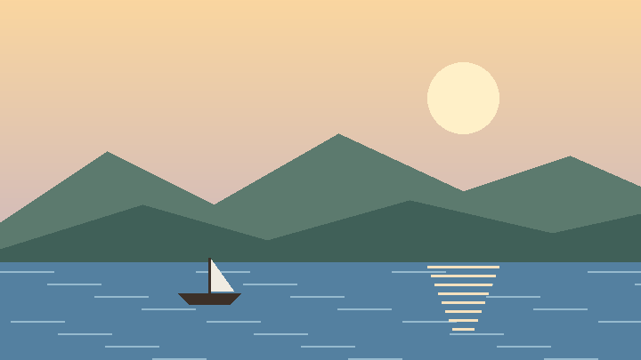

# Example: A walk by the lake

An example note of the [Schnipsle manual](schnipsle-manual.md): a note with a picture, as you might write after a day out.

We set off early, before the wind came up. The water was still, and a single boat was out. Around the lake it is about **eleven kilometres**; we took the path on the east side, which has more shade.

Next time:

- start from the station, not the car park;
- bring something to eat for the hut, which is closed on Mondays.

Put the cursor on the line of the picture to see its Markdown. Paste or drop a picture of your own below, or add one with **Image** ([Notes and pictures](notes-and-pictures.md)).

#schnipsle_manual #schnipsle_manual/travel
