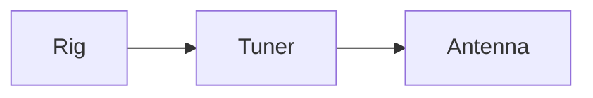

# Abendlied


```{=openxml}
<w:p><w:pPr><w:keepNext/><w:spacing w:before="120" w:after="0"/></w:pPr><w:r><w:rPr><w:b/><w:sz w:val="28"/></w:rPr><w:t xml:space="preserve">Abendlied</w:t></w:r></w:p>
<w:p><w:pPr><w:spacing w:before="0" w:after="0"/></w:pPr><w:r><w:rPr><w:color w:val="6E6E73"/><w:sz w:val="18"/></w:rPr><w:t xml:space="preserve">Key G</w:t></w:r></w:p>
<w:p><w:pPr><w:keepNext/><w:spacing w:before="0" w:after="0"/></w:pPr><w:r><w:rPr><w:rFonts w:ascii="Courier New" w:hAnsi="Courier New" w:cs="Courier New"/><w:b/><w:color w:val="0A66D8"/><w:sz w:val="20"/></w:rPr><w:t xml:space="preserve">    G             D</w:t></w:r></w:p>
<w:p><w:pPr><w:spacing w:before="0" w:after="0"/></w:pPr><w:r><w:rPr><w:rFonts w:ascii="Courier New" w:hAnsi="Courier New" w:cs="Courier New"/><w:sz w:val="20"/></w:rPr><w:t xml:space="preserve">Der Mond ist aufgegangen,</w:t></w:r></w:p>
<w:p><w:pPr><w:keepNext/><w:spacing w:before="0" w:after="0"/></w:pPr><w:r><w:rPr><w:rFonts w:ascii="Courier New" w:hAnsi="Courier New" w:cs="Courier New"/><w:b/><w:color w:val="0A66D8"/><w:sz w:val="20"/></w:rPr><w:t xml:space="preserve">    G                 C   D</w:t></w:r></w:p>
<w:p><w:pPr><w:spacing w:before="0" w:after="0"/></w:pPr><w:r><w:rPr><w:rFonts w:ascii="Courier New" w:hAnsi="Courier New" w:cs="Courier New"/><w:sz w:val="20"/></w:rPr><w:t xml:space="preserve">die goldnen Sternlein prangen</w:t></w:r></w:p>
```




Inline math `$E = mc^2$` and a block:

    $$
    f = \frac{c}{\lambda}
    $$

