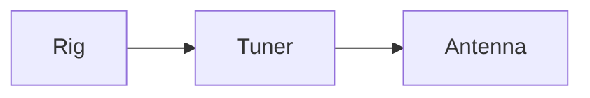

# Abendlied


```{=html}
<div class="song">
<div class="song-title">Abendlied</div>
<div class="song-details">Key G</div>
<div class="song-section song-verse">
<div class="song-line song-chorded"><span class="song-seg"><span class="song-chord"></span><span class="song-text">Der </span></span><span class="song-seg"><span class="song-chord">G</span><span class="song-text">Mond ist aufge</span></span><span class="song-seg"><span class="song-chord">D</span><span class="song-text">gangen,</span></span></div>
<div class="song-line song-chorded"><span class="song-seg"><span class="song-chord"></span><span class="song-text">die </span></span><span class="song-seg"><span class="song-chord">G</span><span class="song-text">goldnen Sternlein </span></span><span class="song-seg"><span class="song-chord">C</span><span class="song-text">pran</span></span><span class="song-seg"><span class="song-chord">D</span><span class="song-text">gen</span></span></div>
</div>
</div>
```




Inline math `$E = mc^2$` and a block:

    $$
    f = \frac{c}{\lambda}
    $$

