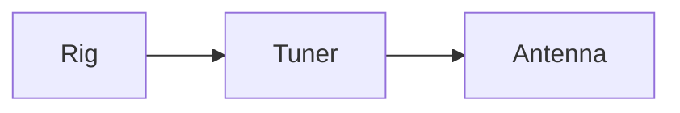

# Welcome {#note-welcome}

This vault holds **sample notes** for the exporters, with *emphasis*,
~~strikethrough~~ and `inline code`. A line ends here\
with a hard break.

## Links

- A page on the web: [Schnipsle](https://github.com/oe1wkl/schnipsle)
- An address: [write to the club](mailto:club@example.org)
- A bare one: [www.example.org](http://www.example.org) and <https://example.org/qrp>
- A footnote.[^note-welcome-1]

### Tags in the text

Tags such as \#radio and \#projects/tuner stay text in an export.

[^note-welcome-1]:
    Footnotes go to the end of the note.

# Packing list for Field Day {#note-packing-list-for-field-day}

1. Radio
   - Keyer
   - Spare fuses
2. Antenna
3. Logbook

<!-- end list -->

- ☑ Charge the batteries
- ☐ Print the band plan

> Leave nothing behind but footprints.

-----

A literal \#notatag, a colour \#00ff00 and C\# stay as written.

Bring the \#keyer and \#m32.

# Antenna tuner {#note-antenna-tuner}

The finished box:


The circuit is in the datasheet.

\[Inside, not photographed yet\]

[A picture on the web](https://example.org/images/tuner.jpg)

See the [welcome note](#note-welcome), the [Packing list for Field Day](#note-packing-list-for-field-day)
and last year's log.

# Bread rolls {#note-bread-rolls}


| Ingredient | Amount | Note |
| :-- | --: | :-: |
| Flour | 500 g | type 700 |
| Water | 320 g | cold |
| Salt | 10 g |  |

```text
Bake at 230 °C for 20 minutes.
```

    Indented code is code too.

# Abendlied {#note-abendlied}


```{=html}
<div class="song">
<div class="song-title">Abendlied</div>
<div class="song-details">Key G</div>
<div class="song-section song-verse">
<div class="song-line song-chorded"><span class="song-seg"><span class="song-chord"></span><span class="song-text">Der </span></span><span class="song-seg"><span class="song-chord">G</span><span class="song-text">Mond ist aufge</span></span><span class="song-seg"><span class="song-chord">D</span><span class="song-text">gangen,</span></span></div>
<div class="song-line song-chorded"><span class="song-seg"><span class="song-chord"></span><span class="song-text">die </span></span><span class="song-seg"><span class="song-chord">G</span><span class="song-text">goldnen Sternlein </span></span><span class="song-seg"><span class="song-chord">C</span><span class="song-text">pran</span></span><span class="song-seg"><span class="song-chord">D</span><span class="song-text">gen</span></span></div>
</div>
</div>
```




Inline math `$E = mc^2$` and a block:

    $$
    f = \frac{c}{\lambda}
    $$

# Raw HTML {#note-raw-html}

Text with <b>bold</b>, <kbd>Ctrl</kbd>, <span>a span</span> and H<sub>2</sub>O.

A div with a handler; its text stays.

