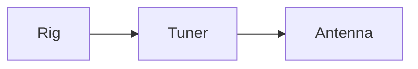

# Abendlied

```chordpro nosource
{title: Abendlied}
{key: G}

{start_of_verse}
Der [G]Mond ist aufge[D]gangen,
die [G]goldnen Sternlein [C]pran[D]gen
{end_of_verse}
```

```abc
X:1
T:Kanon
M:4/4
L:1/4
K:D
f2 e2 | d2 c2 |
```



Inline math $E = mc^2$ and a block:

$$
f = \frac{c}{\lambda}
$$
